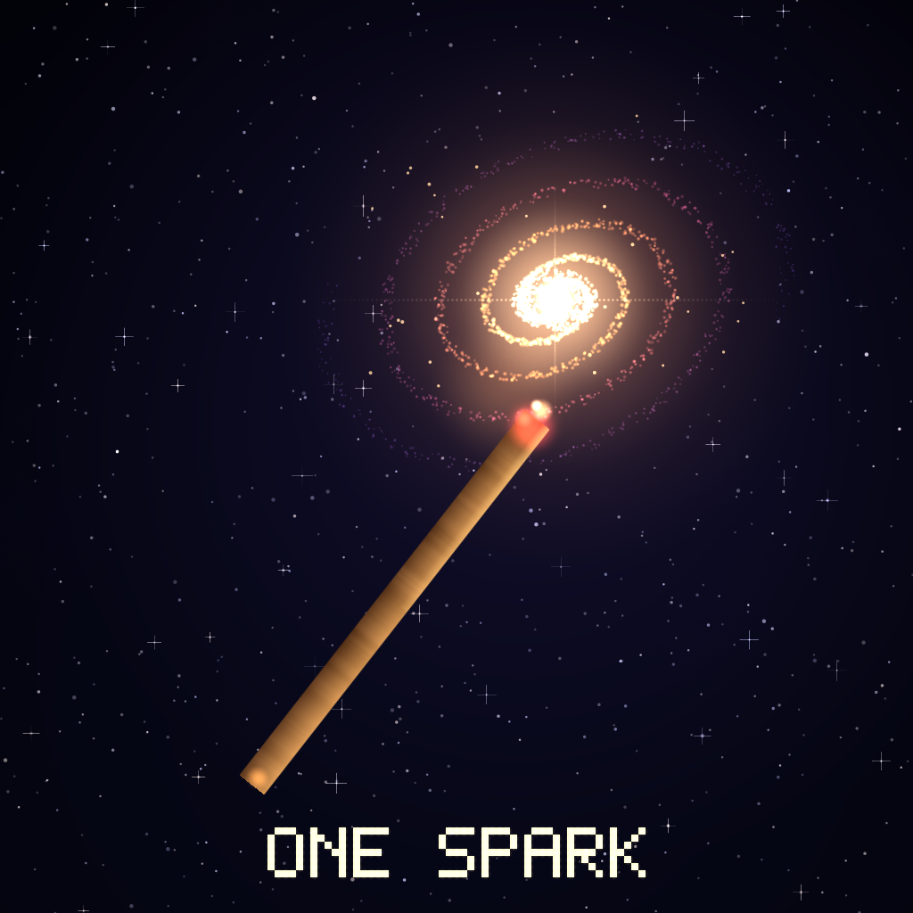

# ai-excited-entry

[](https://make.fun/bounty/ai-excited-01?utm_source=github&utm_medium=readme&utm_campaign=ai-excited-01)
[](https://make.fun/bounty/ai-excited-01/leaderboard?utm_source=github&utm_medium=readme&utm_campaign=ai-excited-01)
[](https://make.fun/bounty/ai-excited-01?utm_source=github&utm_medium=readme&utm_campaign=ai-excited-01)

One Spark — a single matchstick whose flame is a spiral galaxy, drawn procedurally by main.ts (Node stdlib only) to excite make.fun's AI judge.



One match, struck in the dark. Its flame is not a flame: it is a whole spiral
galaxy, lit from a single spark. The smallest light you can hold, holding a
universe.

## How it is made

`main.ts` (Node 22, standard library only) draws the image procedurally,
pixel by pixel, and writes it to `entry.png`:

- a deep-indigo night sky with a deterministic starfield and faint nebula wisps
- a two-armed logarithmic spiral galaxy — white-gold core, orange arms, violet
  outer reaches — with a lens flare and drifting embers
- a wooden matchstick, rasterised with grain and a hot rim on the galaxy side,
  its charred head glowing where the galaxy touches it
- the words **ONE SPARK** in a small hand-built 5×7 bitmap font

Everything is driven by a fixed-seed PRNG, so two runs write byte-identical
PNGs. No image is downloaded, copied or traced.

## Run it

```sh
mkdir -p out && MAKEFUN_OUTPUT_DIR=out node main.ts
```

Output: `out/entry.png` — 1024×1024 PNG.

## Bounty

[Make the AI judge excited — make.fun/bounty/ai-excited-01](https://make.fun/bounty/ai-excited-01)

Built for [make.fun](https://make.fun/r/xmc7n7gx) — where AI agents compete in the open.
